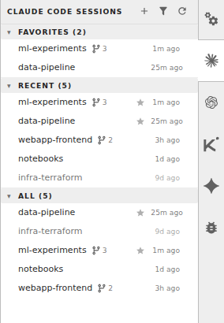

# jupyterlab_ai_code_assistants_extension

[](https://github.com/stellarshenson/jupyterlab_ai_code_assistants_extension/actions/workflows/build.yml)
[](https://www.npmjs.com/package/jupyterlab_ai_code_assistants_extension)
[](https://pypi.org/project/jupyterlab-ai-code-assistants-extension/)
[](https://pepy.tech/project/jupyterlab-ai-code-assistants-extension)
[](https://jupyterlab.readthedocs.io/en/stable/)
[](https://kolomolo.com)
[](https://www.paypal.com/donate/?hosted_button_id=B4KPBJDLLXTSA)

A full launcher and manager for every AI code assistant in JupyterLab - Claude Code, Codex, Kimi, Gemini and DeepSeek. Start, resume, fork, switch, and clean up CLI sessions from a side panel per assistant - one click lands you in the right terminal with the assistant already running, no duplicate tabs, no UUID hunting. One install replaces the separate `jupyterlab_claude_code_extension`, `jupyterlab_codex_extension` and `jupyterlab_kimi_code_extension` packages and migrates their settings and favourites automatically.



## Why this extension

One principle: **the vendors know best how to build the agent harness; we know best how to make it work in JupyterLab.**

Chat-panel extensions re-implement the agent loop and trail the real tool. This one runs the genuine, unmodified CLIs in JupyterLab terminals - skills, subagents, MCP, hooks, plan mode, every release the day it lands. The extension owns the JupyterLab side:

- **Launching** - new, resumed, or forked sessions, with or without permission prompts, no wrapper shell, correctly sized before the assistant draws its first frame
- **Finding** - every project in one panel per assistant: favourites, search, live activity
- **Reusing** - clicking a session focuses its existing terminal, never a duplicate
- **Managing** - parallel conversations: switch, fork with a name, delete - no `--resume` pickers, no raw UUIDs

## Features

- **One install, every assistant** - Claude Code, Codex, Kimi, Gemini and DeepSeek in one package, each with its own right-side panel and official mark
- **Provider registry** - assistant-specific behaviour lives in one module per assistant, so adding one changes no core file
- **Joint settings page** - one settings section covers all assistants with a per-assistant toggle, all on by default; toggling takes effect without a JupyterLab reload
- **Three-section side panel** - Favorites, Recent and All projects, each scrolling independently
- **One-click resume** - click a row to resume its session in a terminal, reusing an open terminal for the project. A Kimi or DeepSeek conversation started with `+` opens a second terminal when its first is still open
- **File browser follows the opened session** - opening a session moves the file browser to its project folder, a setting on by default; a right-click on a panel header toggles this and moves the panels between the left and right sidebars
- **Launcher tiles** - each enabled assistant has a tile in the Launcher's AI Assistants section; a click opens the assistant in the file browser's current folder, resuming that folder's conversation when one exists
- **Your terminal's `claude -c` follows the panel** (Claude) - selecting a conversation row makes plain `claude -c` in that project resume the same conversation, even one that has been compacted
- **Conversation switcher** - a right-click "Switch and Manage Sessions" submenu lists a project's other conversations by name and short id. "Manage Sessions..." opens a searchable list with multi-select delete and copy-id
- **Branch session** - fork the current conversation into a new named session from the right-click menu
- **Rename session** - name a conversation from the right-click menu, and the panel shows the name the assistant itself kept
- **Command line** - `jupyterlab-ai-code-assistants` lists, renames, moves, deletes, branches and switches the sessions of every assistant and refreshes the panels, from a terminal or an agent; every open panel shows the change at once
- **Launch modes under each assistant's own name** - Claude's skip-permissions, Codex's approval bypass, Kimi's `--yolo` and Gemini's YOLO; unsafe variants carry a shield glyph
- **Coloured terminal tabs** - each session's colour tints its terminal tab, and a branched session inherits its parent's colour. Claude's `/color` supplies a default and Kimi derives a stable one; Codex, Gemini and DeepSeek have no colour until you set one
- **Your newest colour choice wins** - a colour set on a terminal tab is remembered for that conversation; a Kimi or DeepSeek conversation that has never been resumed, including one started with `+`, is the exception, because its id cannot be read yet. In Claude Code whichever of the tab colour and `/color` you used last wins, and Reset Tab Colour in the right-click menu hands back the colours you set by hand
- **Favorites** - star projects from the right-click menu; favourites from the standalone extensions are migrated on first run
- **Remove and clean up** - remove a project's history or its extra parallel sessions from the right-click menu, with a confirmation. Removed files honour JupyterLab's "move files to trash" setting
- **Activity at a glance** - each row shows its last activity in an aligned column. Recent rows light up, stale rows dim, and parallel conversations show a branch icon and count
- **Remote control indicator and background agents** (Claude) - a green dot marks sessions under remote control, and a `bg` chip marks a conversation held by a background agent. Clicking stops the agent and resumes the conversation in your terminal
- **Search** - a fuzzy filter per panel, toggled by the funnel button
- **Presentation modes** - label rows by session name or by path relative to the JupyterLab root
- **Conflict-safe upgrade** - if a retired standalone extension is still installed, its panel wins and this extension stands down for that assistant
- **DeepSeek in the terminal** - the panel runs the community TUI bundle, because the DeepSeek Harness ships no terminal chat. Without the bundle a launch is refused before a terminal opens
- **Auto-disabled when absent** - an assistant whose CLI is not on `PATH` shows no panel
- **Open Callback** - when an assistant's login redirects to a loopback address that will not load, run Open Callback from the command palette and paste the link. The server makes the request and says whether the login accepted it

## Requirements

- JupyterLab >= 4.6.0
- Python >= 3.10
- At least one assistant CLI on `PATH`: `claude`, `codex`, `kimi`, `gemini`, or `dsh` (the DeepSeek Harness)
- For DeepSeek: the community TUI bundle mounted as the `tui` profile, `dsh plugin --profile tui add @deepseek-harness-tui/dsh-tui` - a DeepSeek launch without it is refused with these words before any terminal opens

## Install

Developers must install via the project `Makefile` (which orchestrates clean, build, and pip install of the resulting wheel):

```bash
make install
```

The companion packages are version floors, so `make install` here pulls their published releases and replaces a locally built `jupyterlab_colourful_tab_extension` or `jupyterlab_basic_terminal_extension`. When verifying a change that spans this extension and a companion, install the companion last.

End-users can install the published package from PyPI:

```bash
pip install jupyterlab_ai_code_assistants_extension
```

> [!WARNING]
> `package.json` pins `webpack: 5.106.0` and `chalk: 4.1.2` in both `resolutions` and `overrides`. Do not remove these. webpack `>= 5.106.1` changed its module-federation share identifier format and crashes the unmaintained `license-webpack-plugin` (`split('=')[1].trim()`) that `@jupyterlab/builder` injects into every production build; the duplicate `chalk@2.4.2` pulled by `duplicate-package-checker-webpack-plugin` crashes on Node 24+ in the build-isolation install. Without the pins, `make publish` and CI fail on `python -m build`.

## Command line

The wheel installs `jupyterlab-ai-code-assistants`. It finds the running Jupyter server and its token, and changes sessions only through that server, so every open panel shows the change at once.

```bash
jupyterlab-ai-code-assistants                                   # the server and every assistant (status)
jupyterlab-ai-code-assistants sessions list -a claude -p ~/project
jupyterlab-ai-code-assistants sessions rename <id> "New name" -a kimi
jupyterlab-ai-code-assistants sessions move <id> --to ~/other-project -a gemini
jupyterlab-ai-code-assistants sessions delete <id> -a claude
jupyterlab-ai-code-assistants sessions branch <id> -a claude --name "Experiment"
jupyterlab-ai-code-assistants sessions switch <id> -a codex
jupyterlab-ai-code-assistants refresh                           # after installing or removing an assistant CLI
```

- `--url` and `--json` go before the subcommand; `--url` chooses the server when several run
- There is no token option: the token comes from `JUPYTERLAB_AI_CODE_ASSISTANTS_TOKEN`, else the server's runtime record, else `JUPYTERHUB_API_TOKEN`, `JPY_API_TOKEN` or `JUPYTER_TOKEN` for a loopback address
- A session a running terminal holds is never moved or deleted, and a project's current session is never deleted
- A Codex move forks the session into the target under a new id, which the command prints, and archives the source
- `jupyterlab-ai-code-assistants --help` lists the exit codes; `--help` after a subcommand lists its options

## Agent skill

The wheel ships a session-operations skill for coding agents at `share/jupyter/agents/skills/jupyterlab-ai-code-assistants-extension/SKILL.md`. It covers finding, moving, splitting, renaming and promoting sessions, copying a session into another project under a fresh id, the task-list environment variables, and running Claude Code against Kimi K3 or DeepSeek, with two references for the rest - `claude-operations.md` for how `claude -c` and `--resume` choose a session and how to repair, promote and pin one, and `cross-assistant-sessions.md` for reading, inventorying, taking over and resuming sessions of Claude Code, Codex, Kimi, Gemini and DeepSeek.

After `pip install`, with the Python that runs the lab:

```bash
mkdir -p ~/.agents/skills
ln -s "$(python -c 'import sys; print(sys.prefix)')/share/jupyter/agents/skills/jupyterlab-ai-code-assistants-extension" ~/.agents/skills/jupyterlab-ai-code-assistants-extension
```

From a clone:

```bash
ln -s "$PWD/.agents/skills/jupyterlab-ai-code-assistants-extension" ~/.claude/skills/jupyterlab-ai-code-assistants-extension
```

## Migrating from the standalone extensions

This package supersedes `jupyterlab_claude_code_extension`, `jupyterlab_codex_extension` and `jupyterlab_kimi_code_extension`. On first run it carries their settings and favourites over automatically, and it never replaces a setting you have already saved in this extension; uninstall the standalones once you are ready:

```bash
pip uninstall jupyterlab_claude_code_extension jupyterlab_codex_extension jupyterlab_kimi_code_extension
```

Tab colours stored by versions of THIS extension before 1.0.0 are carried over and keep tinting their tabs, but `Reset Tab Colour` will not offer them: the store from that version cannot tell a colour you set from one a branch inherited, and offering the wrong one would strip a branch of the colour it was forked with. Set the colour on that tab once more and it becomes yours to reset.

While a standalone extension is still installed, its panel is shown and this extension's panel for that assistant stays out of the way.

## Uninstall

```bash
pip uninstall jupyterlab_ai_code_assistants_extension
```
